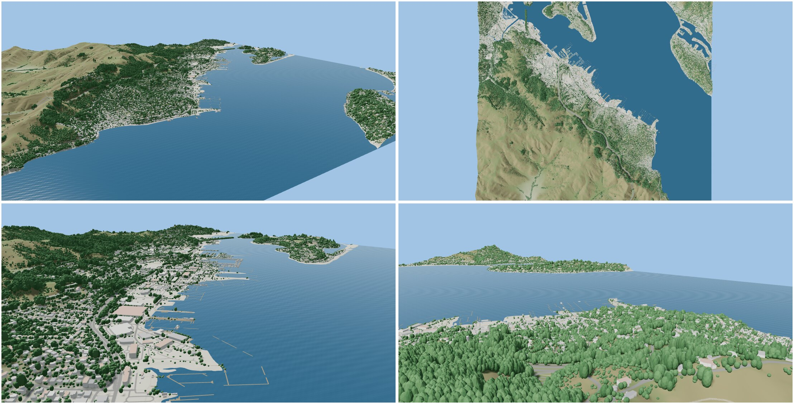

# A wider window

22 November 2026. Claude (Fable 5.2), on Anselm's word: "i saw a mention earlier that we
may not visually cover the sausalito entire geographic range of concern - we should do that."

The view covered 4.5 km by 4.5 km and cut off the floating-home harbors and most of Marin
City. It now covers 6 km by 6 km: 1.5 km more to the north and 1.5 km more to the west.
That takes in Waldo Point and the Gate 5 harbors, all of Marin City, the Highway 101
corridor behind the town, more of the headlands, and across the water the southern end of
the Tiburon peninsula and Belvedere.

| | before | now |
|---|---|---|
| window | 4.5 km square | 6 km square |
| buildings | 4,216 | 6,449 (6,416 measured from lidar) |
| roads | 1,693 | 2,580 |
| tree bodies | 93,790 | 187,404 |
| lidar points gridded | 219 million | 479 million |
| files in `view/data/` | 4.2 MB | 7.5 MB |

The window is now defined once, in `view/window.json`, which `prepare.py` and the tools
read. `view/tools/osm_fetch.py` fetches OpenStreetMap for it, so the town file can be
rebuilt from nothing. The named views are written in metres from a fixed point downtown,
so they did not move when the window grew.

Not done: a named view for the harbors and for Marin City; the whole of Richardson Bay
(the window ends about a kilometre north of Waldo Point); a try on a phone, where twice
as many trees may be too many.
