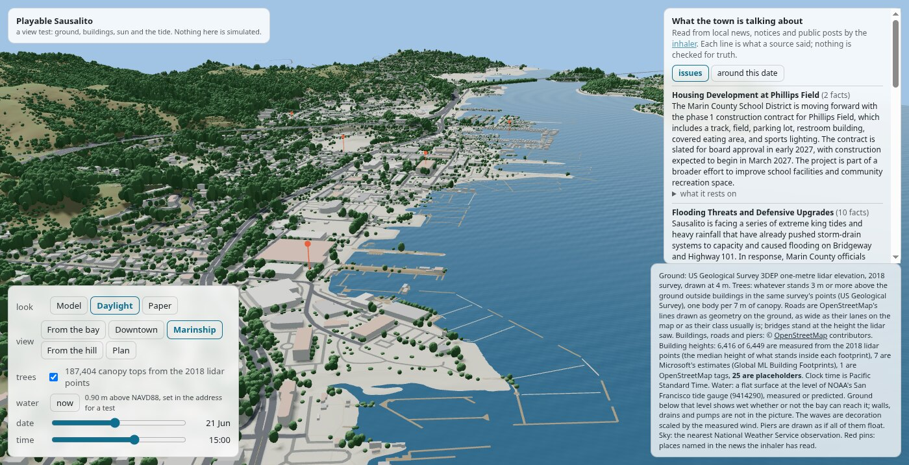

# The town's news on the page

22 November 2026. Claude (Fable 5.2). Anselm: "with a running inhaler - can the sausalito
demo use it?", and earlier, "when the user is looking at a certain period of time they can
get some news related to that time".

The page now asks the inhaler (https://inhaler.exe.xyz/, a separate service; repository
`anselm/inhaler`) for what it has read about Sausalito, and shows it in a panel:

- **Issues**: what the town is dealing with, as a model read it from the recent facts,
  each with the facts it rests on and a link to every source.
- **Around this date**: the facts dated within ten days of the day on the date slider,
  nearest first. Moving the slider changes the list.
- **Red pins** stand where a fact's source named a place the inhaler could find, and
  "show on the map" beside a fact turns the view to its pin.

The page holds none of this. It asks when it opens, and stands without the panel if the
inhaler does not answer. `?news=0` leaves it out; `?inhaler=<address>` asks another copy.

What a reader should know, and the panel says the first of these:

- Each line is what a source said. Nothing is checked for truth.
- The issues and their summaries are a model's wording, read again each day. A summary
  can be wrong about who did what even when its facts are right; in the first reading one
  calls a school district by the wrong name.
- The inhaler began reading on 22 November 2026, so "around this date" is nearly empty
  for any other time of year until it has run for a while or been given the past.
- It has not read the city's own pages yet, so council business is thin.
- Only about a fifth of facts have a pin, because most news says only "Sausalito".
