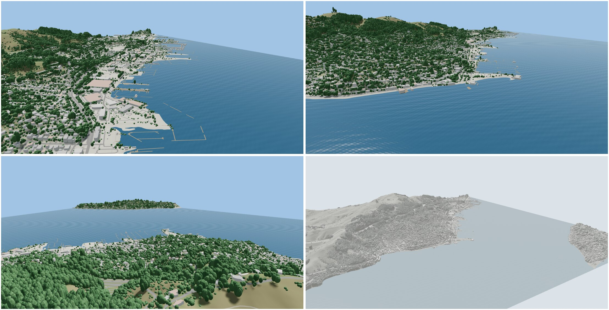

# Reading the lidar points

22 November 2026. Done by Claude (Fable 5.2, working from the esimv1 room on canada1) on
Anselm's word: "ok read the lidar - extract what we can".

## What came out

- **Building heights are measured.** 4,194 of the 4,216 OpenStreetMap footprints now carry
  a height measured from the survey's points. The 22 left are footprints where the survey
  saw nothing standing (built since 2018, or drawn off their true place); two are
  houseboats. Before today 3,355 heights were Microsoft's estimates, 36 were map tags and
  825 were placeholders.
- **Microsoft's estimates were close.** Over the 3,346 buildings that have both, the
  estimate is 0.4 m lower at the median, half are within 1.2 m of the measurement and
  nine tenths within 3.3 m. The placeholders were 0.7 m low at the median, half within
  1.7 m. So the earlier pictures were not far wrong, and now they do not rest on a guess.
- **Houseboats are measured too**: 433 of 435, as height above the water the survey saw.
- **Trees come from a source with known terms.** 93,790 canopy tops from the same points,
  in place of 86,885 from the canopy model whose terms are not stated. The US Geological
  Survey's lidar is public domain, so `view/data/trees.bin` is now in the repository.

## How

The survey is USGS project CA_NoCal_Wildfires_B5b_QL1_2018, the one the one-metre ground
came from. Its tiles on the USGS file server came at about 0.1 MB a second (284 MB of
2 GB in an hour), so I stopped that and read the same survey from the USGS open-data
bucket on Amazon, where it is kept as an octree (Entwine Point Tiles). `view/tools/ept_list.py`
lists the pieces over the window, to depth 10, which is every point on a grid of about
0.56 m and coarser. That was 5,701 pieces, 1.3 GB, fetched in 31 seconds.

`view/tools/lidar_surface.py` keeps the highest return in each one-metre cell, leaving
out points the survey classed as noise: 219 million points in the window, 94 percent of
cells with at least one, 11.5 points per covered cell. Less the one-metre bare ground,
that is the height of whatever stands in each cell. It took 8 seconds on 24 threads.

`view/prepare.py` then takes, for each footprint, the median of that height over the
cells inside it that stand 2 m or more up, when those are at least three tenths of the
footprint. A pitched roof is therefore drawn at about its mid-slope, and a tree over one
corner does not lift the box. The page draws a measured height from the mean ground
under the building; it used to draw from the high side of the slope.

Trees are what stands 3 m or more up, outside footprints grown by 2 m and at least three
cells from the water, one per 7 m cell at the highest point, and only where a fifth of
the cell stands 2 m up, which leaves out power lines and masts.

It needs `laspy` with a LAZ reader and `pyproj`. They are in a private Python environment
at `~/.cache/sausalito-venv` on canada1 and are not a dependency of the page.

## What it does not give

- **Floor heights.** The lidar sees roofs and ground. A flood question needs the height
  of the lowest floor and the doorsill, which come from elevation certificates or a
  survey on foot.
- **Roof shapes.** Each building is still a box. The points would support a roof surface
  per building; that is drawing work, not data work.
- **A current town.** The survey is from 2018. Anything built or felled since is wrong.
- **Single trees.** A body per 7 m of canopy is a picture of the canopy. 1,299 bodies are
  over 45 m tall, which is taller than I would expect of many trees here; some will be
  towers, cranes or a steep hillside read through a coarse cell. Not checked.
- **A splat.** The points have no colour, and the page draws no splats.
- **The whole point cloud.** Depth 10 is a thinning. The full survey is denser; nothing
  here needed it.

## Files

`cache/ept/` (the pieces, 1.3 GB), `cache/dsm1.bin` (the surface) and `cache/dem1.bin`
(the one-metre ground) are not in git; the two scripts rebuild them. `view/data/town.json`
carries `heights_lidar` and each building's source (`t`: 3 lidar, 2 Microsoft, 1 tag,
0 placeholder).
