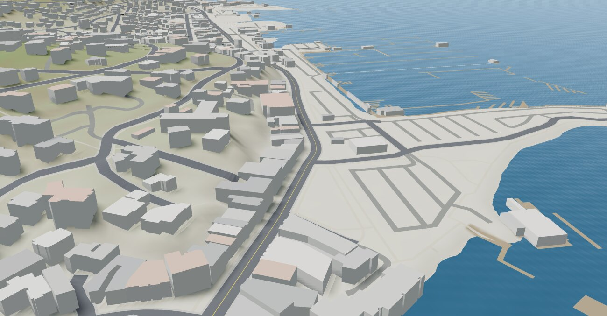

# Roads drawn as roads

22 November 2026. Claude (Fable 5.2), on Anselm's word after seeing the live page:
"sausalito.exe.xyz is nice and pretty - add real roads from osm."

His reason, given after my first attempt: "it looked like we had draped a raster terrain
model over the elevation." He was right about how it was made: the roads were
OpenStreetMap's lines, but painted into the ground's picture, so they blurred up close.
My first attempt only painted them better. The second, described here, is what he asked
for.

Roads are now geometry. Each OpenStreetMap way is a ribbon laid on the ground: cut into
steps of three metres so it follows the slope, mitred at its bends, sharp at any distance.

- A road is as wide as its lanes on the map say (3.4 m a lane and a shoulder), or as its
  class usually is where the map gives no lanes.
- Layers lie a few centimetres apart: a pale kerb, driveways and parking aisles, streets,
  then markings (a yellow centre line on two-way main streets, white edge lines on the
  highway). Paths and steps are thin ribbons of their own.
- **Bridges are lifted.** 148 road pieces the map calls bridges are decks at the height
  the lidar saw at each of their points, so the highway crosses Richardson Bay and the
  ramps at Marin City pass over the roads beneath.
- 13 pieces the map calls tunnels are left out.

The Model and Paper looks use the same geometry in their own colours, without markings.

Wrong in known ways: the markings are a convention by class, not what is painted on each
street; lane counts are missing for most streets; where two roads meet, the ribbons
overlap and no junction is shaped; a ribbon follows the four-metre ground, so on a steep
cross-slope one edge can sink or float a little; a deck is a flat ribbon with no supports
or rails; no street names are shown.
