# View tests: the town as solid ground

> Later the same day the building heights and the trees described below were replaced by
> measurements from the lidar points (`20261122-reading-the-lidar.md`), and the water became a
> sheet at the tide gauge's level (`20261122-water-tide-and-sky.md`). The counts and sources
> below are the state before that.

22 November 2026. Claude (Fable 5.2), esimv1 room on canada1, session
`session_018TGCFiQHbUYn12HkNti2xk`. Anselm asked for visualization tests because
"wireframe is not the right look"; he is "leaning towards more of a solid style - perhaps
with sun position controls. showing buildings is important."

This is a picture of the ground. Nothing in it is simulated, and it does not use esimv1.

## What was built

`view/index.html`, one page drawn with three.js: the terrain as a lit surface, every
building as a solid body, roads and piers painted on the ground, the bay, and a sun
placed by a date slider and a clock slider, casting shadows. Three looks to choose
between, and five fixed viewpoints.

| Look | What it is |
|---|---|
| Daylight | Natural colours: olive hills, pale flats, blue water, light walls and varied roofs |
| Model | One pale material, like an architect's model; shape and shadow only |
| Paper | Cream land with contour lines, white roads, dark buildings; closest to a printed map |

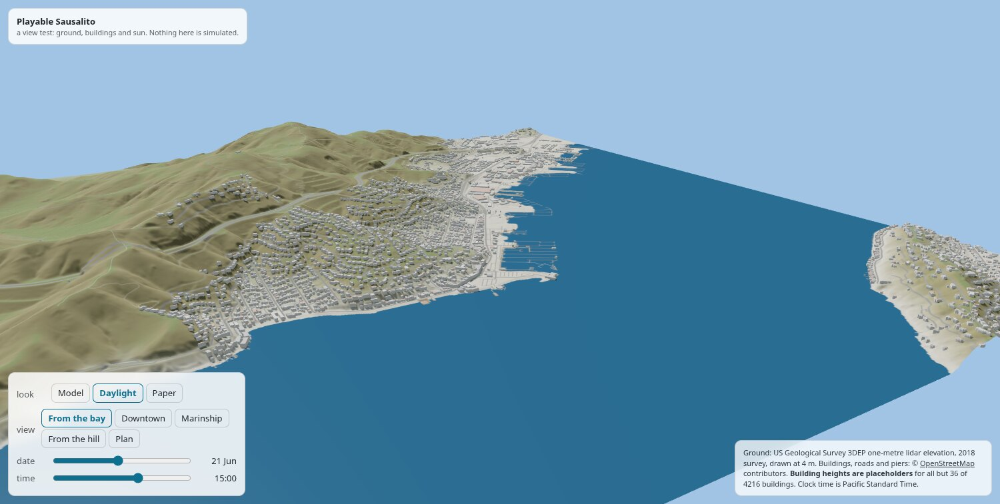
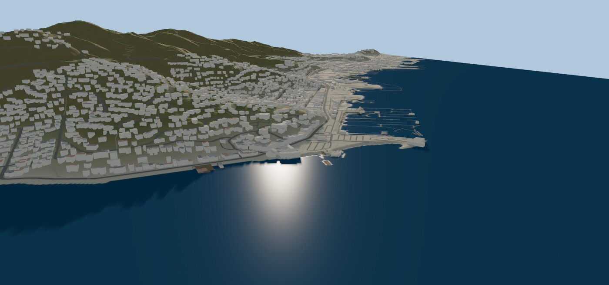
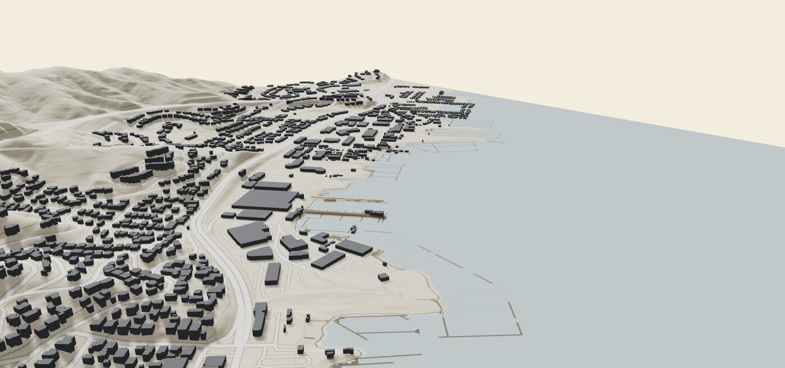
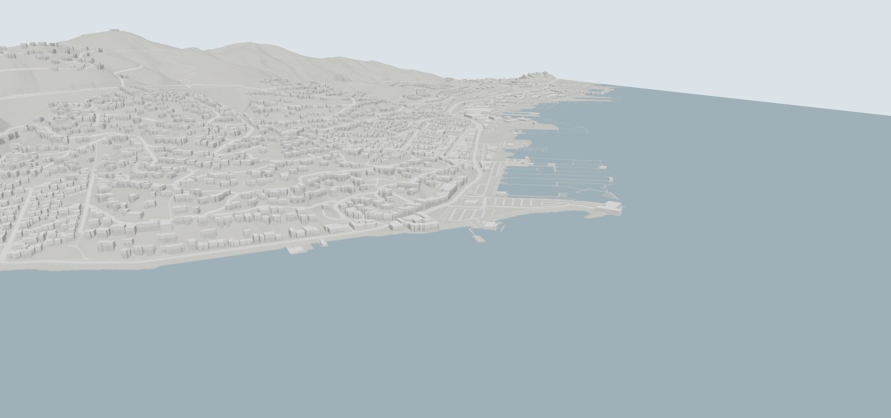
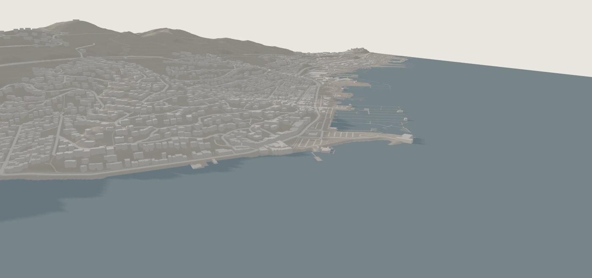
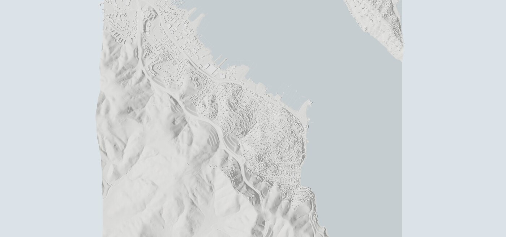

## To run it

```
cd view && python3 -m http.server 5199
```

then open `http://localhost:5199/`. Query parameters set the start: `look` (day, model,
paper), `cam` (bay, downtown, marinship, hill, top), `day` (1 to 365), `hour`, and `bare`
to hide the panels. `node view/tools/shot.mjs <url> <out.png>` takes a headless picture.
It draws in about two seconds on canada1's graphics card. It has not been tried on a
phone.

## Data

- **Ground.** US Geological Survey 3DEP one-metre elevation from lidar, the 2018 survey
  (tiles x54y419 and x54y420 of CA_NoCal_Wildfires_B5b), public domain. Cut to a window
  4.5 km square and averaged to 4 m: `view/data/ground.bin`, 2.5 MB. The 2024 San
  Francisco survey has the same tile name but holds no data north of the Golden Gate.
- **Buildings, roads, piers.** OpenStreetMap through Overpass, as of 22 November 2026:
  4,216 buildings in the window (435 tagged as houseboats), 1,693 road and path lines,
  325 piers. © OpenStreetMap contributors, Open Database Licence.
- `view/prepare.py` rebuilds both files from the downloads in `cache/`, which is not in
  git (460 MB). It needs GDAL's command-line tools and numpy.

## What is wrong with it

- **Building heights are placeholders.** OpenStreetMap carries a height or a storey
  count for 36 of the 4,216 buildings. The rest are given a height by kind (6.5 m for a
  plain building, 4.5 m for a houseboat, and so on), so the town looks like rows of equal
  boxes and its shadows are not to be trusted. The fix is the lidar point cloud: the
  highest return over each footprint, less the ground. That is 30 or so files of about
  100 MB each and a reader we do not have yet.
- The bay is the survey's flattened water surface, a flat sheet at -0.3 m. There is no
  bathymetry, no tide and no wave.
- Trees were missing in the first pass and were added later the same day (below).
- The sun's position uses low-precision formulas and standard time all year. It has not
  been checked against an almanac.
- The window cuts off the floating-home harbors to the north and most of Marin City.

## Later the same day: trees, and a search for more data

Anselm: "It's a shame we don't have tree data. Maybe there are gaussian splats of the area ...
I know cesium may have 3d tiles. Surely there must be more data?"

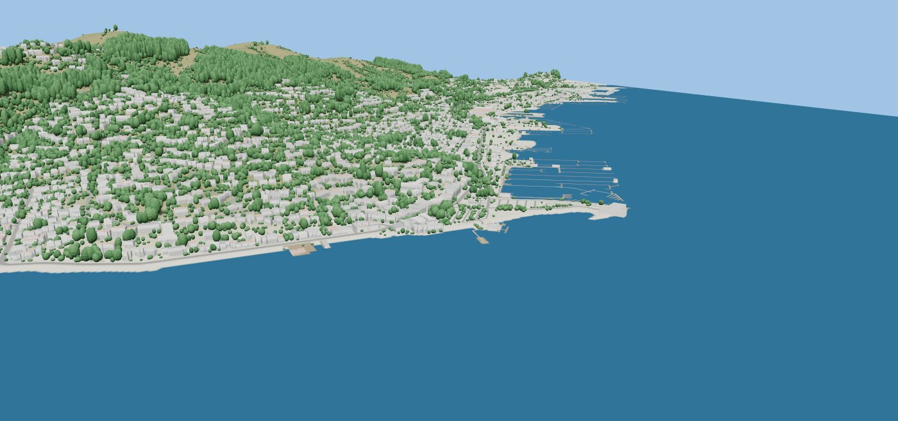
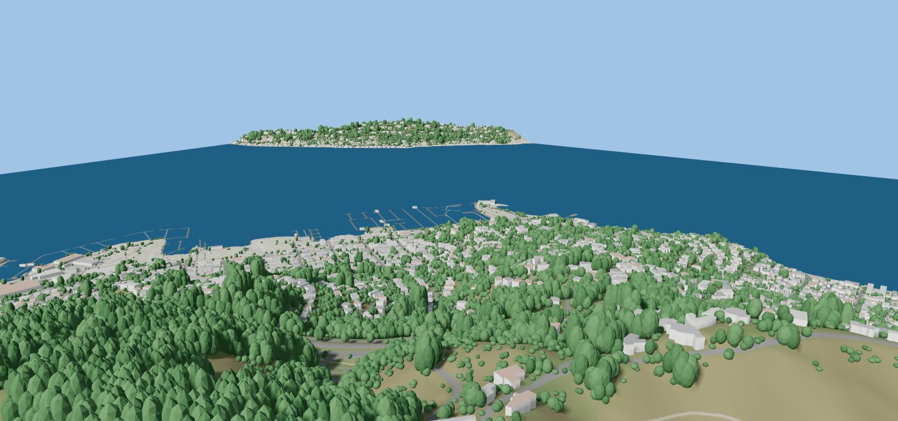
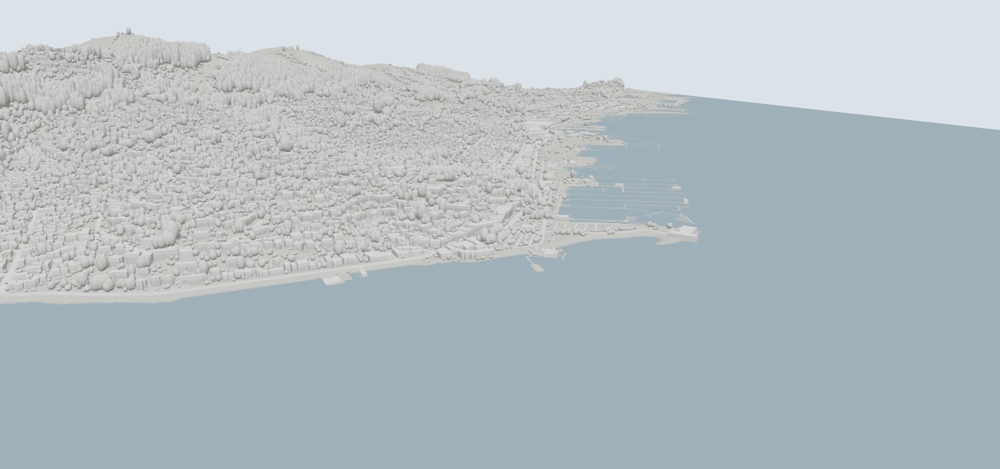
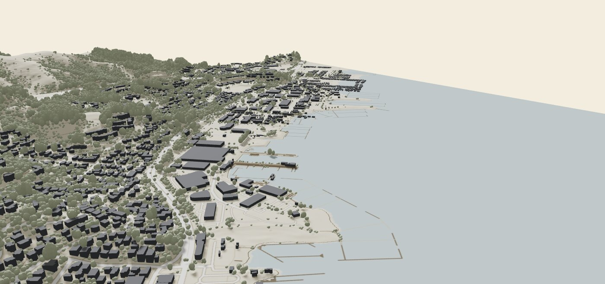

- **Trees are in.** A canopy height model at about one metre covers Marin, made from lidar
  flown in 2018 and served from zenith.cnr.berkeley.edu (service `CHM_8COUNTY`; credited to
  the Golden Gate National Parks Conservancy, OneTam, Tukman Geospatial and others). The view
  draws one rounded body per 7 m of canopy that stands 3 m or more: 86,885 of them in the
  window. It is a picture of the canopy, not a count of trees. The service states no licence,
  so `view/data/trees.bin` is not in git; `view/prepare.py` rebuilds it from an export of the
  service. Its terms have to be found before the file is published.
- **It does not give building heights.** In Marin's part of that model the buildings were
  removed: the median height inside a footprint is about 1 m.
- **Marin County's own footprints** (4,700 in the window, against 4,216 from OpenStreetMap)
  have fields for base and peak elevation, and both are empty for every building here. Most
  outlines date from 2004 aerial photographs.
- **Google's photorealistic 3D tiles** would show the town as photographed, through Cesium or
  three.js. Google's terms forbid storing them, using them offline or deriving data from them,
  and they need a paid key. They cannot be part of an open repository, and a simulation could
  not read them. They could be a backdrop in a hosted page and nothing more.
- **Gaussian splats.** A search found none of Sausalito that is published. One could be made
  from a drone flight or from walking video, of a street or a harbor more readily than a town.
- **Still to try for building heights:** the lidar point cloud itself (US Geological Survey,
  public domain), and Overture's building heights, some of which were derived from that lidar.
  Aerial photographs from the national programme (NAIP, public domain) could colour the ground.

## Later again: building heights

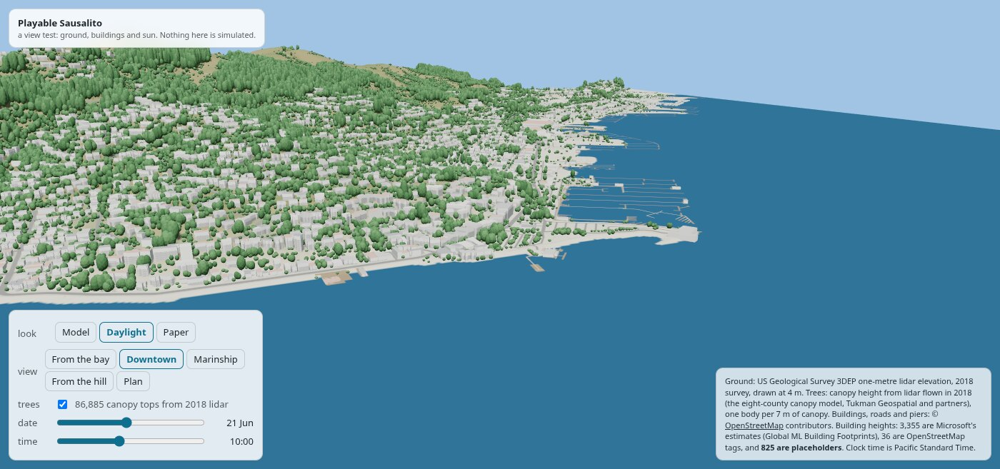
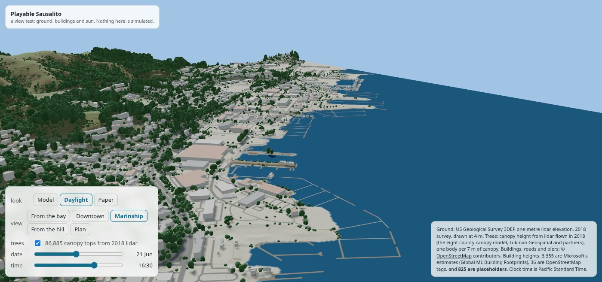

The second research pass found that Microsoft's Global ML Building Footprints carry a height
for most buildings here, under a permissive licence (CDLA Permissive 2.0). `view/prepare.py`
now gives each OpenStreetMap building the height of the Microsoft footprint at the same
place: 3,355 of 4,216 buildings. 36 keep their OpenStreetMap tag and 825 are still
placeholders, among them the houseboats. Microsoft's heights are estimates whose method and
date are not stated per building; the median here is 6.0 m and the tallest 19.3 m. They have
not been compared with the lidar. The building shadows are now roughly right in length and
still not to be relied on for any one building.

## Open

- Which look, or which mix of them.
- Whether the window should grow north and west.
- This page is a hand-written three.js file. Whether the eventual view is built here or
  as a part of esimv1's viewer is the open question in esimv1's devlog of the same day.
