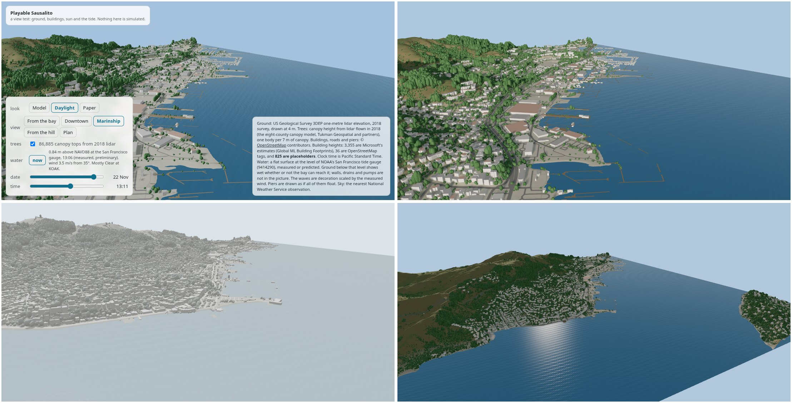

# Water, the tide and the sky on the view

22 November 2026. Built by Claude (Fable 5.2, working from the esimv1 room on canada1) on
Anselm's word:

> can do some kind of shader based water model if useful. perhaps real weather? this is
> more for just visual appeal than real 'simulation value'.

> ok enrich water and weather. can these be products that can be shared by other
> projects? maybe we need a data catalog?

## What the page does now



- **The water is a sheet at a measured level.** On opening, the page asks NOAA's San
  Francisco tide gauge (station 9414290, at Crissy Field, about six kilometres south of
  the town) for its latest water level in metres above NAVD88. The lidar ground is in the
  same datum, so the level is drawn on the ground with no conversion. On the afternoon of
  the build it read 0.84 m, marked preliminary by NOAA.
- **A chosen moment uses the predicted tide.** Moving the date or time slider asks NOAA
  for its harmonic prediction for that day (the current year) and reads the hour off it.
  A prediction leaves out weather: surge, wind setup and river flow.
- **The wind moves the waves.** The gauge has an anemometer. Its speed sets how steep the
  waves are and its direction sets where they travel.
- **The sky lights the scene.** The page asks the National Weather Service for the latest
  observation near the town. It asks the ten nearest stations at once and takes the
  nearest that reports cloud cover, because the nearest stations are small ones that
  report none (the first try read "sky not described"; on the build day the answer came
  from Oakland airport, KOAK, 25 km away). Cloud cover dims the sun and greys the sky;
  reported visibility sets how far the haze begins.
- **Houseboats and piers ride on the water.** Houseboats rise and fall with the level.
  Piers are drawn half a metre above it.

## What is measured and what is decoration

Measured: the water level, the wind at the gauge, the sky at the weather station, the
ground, the sun's position.

Decoration: the waves. They are six trains of sine waves. There is no fetch, depth,
current or swell in them, and they say nothing about the sea state off Sausalito. The
page's credit panel says so.

Wrong in known ways:

- The level is San Francisco's. Sausalito's own tide differs a little in height and time;
  no correction is applied.
- The sheet is flat. Ground below the level shows wet whether or not the bay can reach
  it, and nothing drains. That is a picture of a level, not a flood model. At 2.2 m, a
  king-tide level set by hand for a test, I could not see standing water on the Marinship
  in the render, and I have not checked which ground is below that level.
- The ground has no sea bed: the lidar saw the water surface at about -0.3 m. A tide
  below that is drawn at that level.
- Every pier floats here. Fixed piers do not.
- The sky is Oakland's when nothing nearer reports cloud. Fog in the Golden Gate will be
  missed.

## Three parts another project can use

They are in `view/lib/`, and none names Sausalito:

| file | what it gives | source |
|---|---|---|
| `tide.js` | `tideNow(station)`, `tidePredicted(station, when)`: level in metres NAVD88, and the gauge's wind | NOAA CO-OPS data API, public domain |
| `sky.js` | `skyNow(lat, lon)`: cloud cover, visibility, temperature, wind, the station's words | api.weather.gov, public domain, United States only |
| `water.js` | `makeWater(THREE, { width, depth })`: a three.js sheet with `set()` for level, wind, sun and colours | none; decoration |

Both services answer a browser from any origin (checked today with an `Origin` header),
so no server of ours stands between the page and the gauge.

They are files in this repository for now. Their home, once it exists, is the viewer
package (`esimv1-viewer` in the esimv1 devlog of this day).

## On a data catalog and on object storage

esimv1 has a catalog already (`core/data/catalog.toml`): every source with its licence,
the day it was checked, and a hash of what was fetched. It covers what the engine fetches.
It does not cover what a page fetches live, and a scenario outside the engine cannot add
to it. Both are small extensions of the same file format and are noted as chores. A
second catalog is not needed.

These live feeds need no storage: the browser reads them from NOAA each time. Storage is
needed for derived files that are too big for git or that several repositories share.
Nothing in this view is there yet (the ground is 2.5 MB, the town 1.1 MB). The first real
cases will be the lidar height raster if it is published at one metre, and finished runs
once the hub and the engine are separate repositories.

## How to see it

```
cd view && python3 -m http.server 5199
http://127.0.0.1:5199/                      now: measured level, wind and sky
http://127.0.0.1:5199/?day=20&hour=9        a chosen moment: predicted tide
http://127.0.0.1:5199/?level=2.2&still      a level set by hand, waves frozen (for tests)
```

Not tried on a phone. The page now draws every frame while the water moves.
