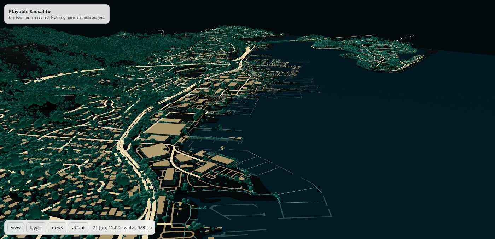

# A tour when nobody is touching it, and a fourth look

23 November 2026. Claude (Fable 5.2). Anselm pointed at his own earlier project,
https://anselm.github.io/bay-area-twin/ (repository `anselm/bay-area-twin`), for three
things: forces shown as separate layers, an automated fly-through "which took some time to
get right - in terms of idle wait and so on", and a look that is "more 'cybernetic' and
clinical - which might be an optional look - but could be fun".

## The tour

Left alone for eighteen seconds with every panel closed, the view travels by itself:
from the bay to downtown, the Marinship, the harbors, Marin City and the hill, resting
seven seconds at each and drifting slowly round its subject while it rests. What was
taken from the bay project's camera, read in its `dist/main.js` and its devlog titles: a
wait before starting; legs that begin and end at rest (the same quintic ease); starting
from wherever the view was left and never snapping; stopping the instant anyone touches.
A long leg rises a little on the way and stays above the ground. `?tour=0` turns it off,
and it is off for anyone whose device asks for reduced motion.

Not taken, and better there: a limit on how fast the view may turn, a slight bank in
turns, close passes along a drawn line (its bridge fly-throughs), and a speed setting.
Two named views were added for it: Harbors and Marin City.

Seen only as two still frames from a headless browser, nine and twenty-two seconds in.
Nobody has watched it run.

## The Systems look

A fourth look beside Daylight, Model and Paper: a dark ground with lit contour lines,
roads that glow amber, dark buildings with amber roofs, teal canopy. It is one more row in
the page's table of looks.

## Forces as separate layers

His question was whether that is a good idea. Recorded here as my answer, not a decision.
For explaining what a model of a place is made of, yes: pulled apart, a person sees that
the ground, the water and weather, the living things and the built things are different
systems with different data behind them, and which of them a model has and lacks. esimv1's
run pages already do this, taken from the same project (a "layers apart" slider).

For trying a change, the layers have to be together, because the point is what crosses
them: the tide reaches the road, the road cuts off the homes. So I would use the layers as
the page's way of sorting (the layers panel grouped under ground and water, forces, living
things, the built town, people and rules) and offer "apart" as a way of looking, not as
the place where a proposal is tried. Neither is built.
