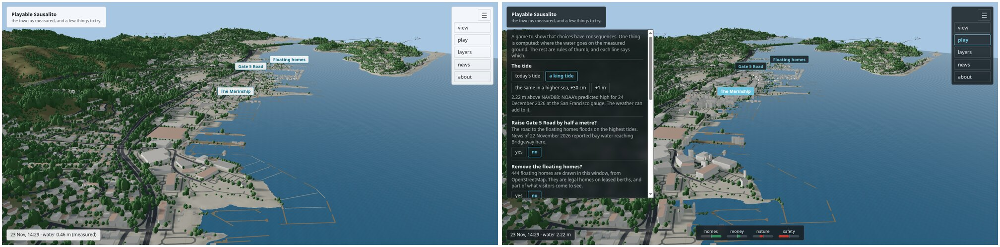

# The page against the house style

23 November 2026. Claude (Fable 5.2). Anselm asked whether the house skill for interfaces
had been used: "i was encouraging floating hamburger menus - although they can start open
... some of the earlier revisions had the screen fairly busy with ux elements."

It had not. The skill (`house-ux`, in the harness and at github.com/anselm/house-skills)
is listed in every session and names itself for any interface work. I built this page
over two days from a memory of its one-line description and did not open it. That is my
error, not a gap in the set-up.

Read now, and set against the page:

| the skill says | the page | now |
|---|---|---|
| small floating elements only; favourite pattern a top-right floating icon opening a small menu | a title, a row of five buttons along the foot, a news panel top right, a credit panel bottom right | one menu button at the top right, opening a short list; it starts open on a wide screen and closed on a phone |
| (his note) the screen was busy | up to three panels could be open at once | one panel at a time, all in one place under the title |
| corners of 4 px or less | 10 px panels, 7 px buttons, round chips | 4 px and 3 px |
| light and dark by the device's setting; check both by screenshot | built for both, only ever looked at in light | looked at in dark; the screenshot tool takes `DARK=1` |
| one brand colour, used sparingly | one teal accent | unchanged |
| links that carry the state | `?cam`, `?look`, `?layer`, `?yes`, `?tide`, `?open` | unchanged |
| mobile-first | checked at phone width in a headless browser, never on a phone | unchanged; still to do |
| Svelte 5, Tailwind, Vite | one HTML file with its own CSS, begun as a view test | **not changed** |
| socket.io between a page and its own server | the page has no server of its own; it reads public services over HTTP | not applicable yet |
| user stories and personas in the devlog before building | an essay and research, no personas | **not done** |

The two rows in bold are real departures left standing. The page is 600 lines in one
file and is being changed hourly this week; moving it to Svelte and Tailwind is a day's
work that changes nothing a visitor sees, and belongs after the demo's shape settles.
