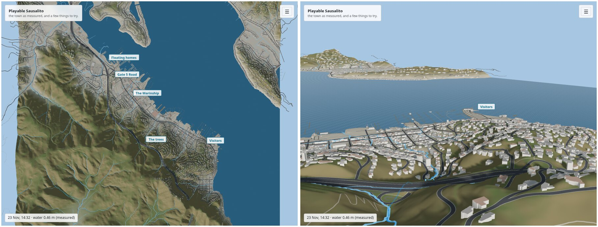

# Creeks, and where rain runs

23 November 2026. Claude (Fable 5.2). Anselm: "is it possible to show the hydrology? i
know the bay area demo had it - there must be a ton of creeks".

Two layers, both drawn as lines on the ground like the roads.

**Creeks, as mapped.** 90 streams and 2 ditches from OpenStreetMap inside the window; 22
of the pieces are marked as running in a culvert or tunnel and are drawn paler. Only one
has a name on the map (Coyote Creek). This layer is on when the page opens.

**Where rain runs.** 293 lines computed in `view/prepare.py` from the four-metre lidar
ground: every cell is given the neighbour its water would leave by, the area draining
through each cell is summed downhill, and a line is drawn wherever two hectares or more
drain through, wider where more does. The largest carries 376 hectares, a valley that
enters the window from outside it. The method lets water rise from the bay and the
window's edges and notes from which side each cell is first reached (the priority flood
of Barnes, Lehman and Mulla, 2014, recalled and not re-read), which carries water across
hollows. It took twelve seconds.

What a reader should not take from the second layer: it is the shape of the bare ground,
not a map of water. In town nearly all of this runs in storm drains and culverts, whose
routes are not public. A road embankment or a building pad in the lidar turns a line
where a pipe in fact passes under. Lines that leave by the window's edge are cut there,
and the areas of lines that enter from outside are too small.

What it is good for: it shows where the hills send their water toward the low ground
along the bay, which is the other half of the flooding the propositions play with. No
rain is in the flood yet.
