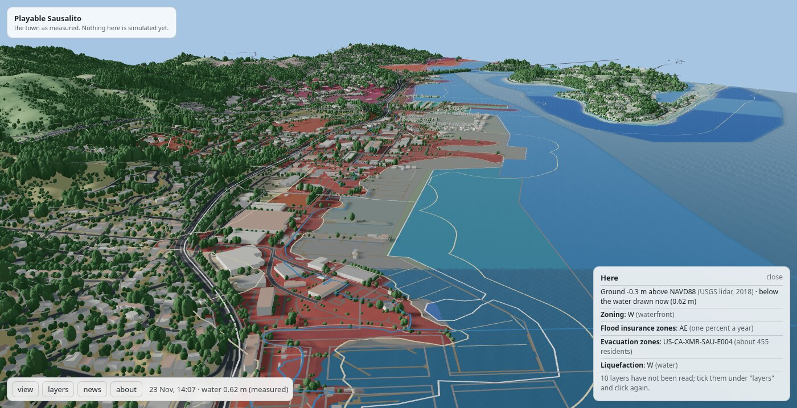

# Public maps on the ground, and how options could be put in front of people

23 November 2026. Claude (Fable 5.2). Anselm: "lets collect other facts about the region -
and paint those", and "speculate about how we can put options in front of people to try out".

## Layers

A fourth button, "layers", lists fourteen public maps. Ticking one asks its publisher for
the part inside the window and draws it: areas as a soft wash over the ground with their
edges as geometry, lines as ribbons, points as pins. Several can be on at once.

| layer | shapes in the window | publisher as read |
|---|---|---|
| Zoning | 299 | Sausalito's zoning map, hosted by Marin County, 2023 |
| General plan | 299 | Sausalito's general plan land uses, hosted by Marin County |
| Flood insurance zones | 142, of which the one-percent-a-year areas are drawn | FEMA National Flood Hazard Layer |
| Sea level rise, 20 inches and 5 feet | 1 each | Marin County's own layers |
| Evacuation zones | 40, with an estimate of residents | Zonehaven, hosted by Marin County, August 2024 |
| Liquefaction | 6 | hosted by Marin County |
| Landslides | 51 | hosted by Marin County |
| Fire hazard | 10 | hosted by Marin County |
| Tsunami hazard area | 2 | California Geological Survey, hosted by Marin County |
| Parks and open space | 52 | hosted by Marin County |
| Parcels | 7,821, lines only | Marin County, given as they are |
| Bus routes | 16 | Golden Gate Transit, hosted by Marin County |
| Schools | 8 | hosted by Marin County |

**A click on the ground or a building opens a card** of what is known at that spot: the
building's height and where the height came from, the ground's elevation and whether it is
below the water drawn now, the value of every layer that has been read, and any news the
inhaler has placed within 120 metres.

Nothing is copied into this repository. Most of these carry no stated licence, so the page
reads each where its publisher serves it, and stands without a layer whose server does not
answer. `?layer=zoning,fema` switches layers on from the address.

Wrong or unknown: the fills are painted at three metres a pixel and are soft at their
edges, by choice, with the edge itself sharp; the meaning of the landslide categories was
not found; the zoning legend shows the first nine kinds met, not all; the publisher's
date is given only where its page states one; a layer drawn over water shows through it;
a click reads only layers already ticked. Not tried on a phone.

## Putting options in front of people

Speculation, for discussion. Nothing here is built, and the first question is not chosen.

**What a person has to be able to do** is small: pick a thing in the town, change it,
press play, and see what is different from not changing it.

1. **Options live on the things, not in a form.** The card that opens on a click is the
   place for them. Click a road: "raise this stretch" with a slider in centimetres. Click
   a parcel on the housing list: "homes here", a number. Click the shoreline: "a wall
   here, this high". A person changes the place by touching the place.
2. **A few ready-made moves first.** Most people will not invent a proposal cold. Three or
   four named ones come with the scenario, each a thing someone in town has actually
   proposed, with who proposed it and a link: "the county's tide gate at Coloma Street",
   "raise Gate 5 Road 40 cm", "do nothing". One press applies it. Changing it afterwards
   is the next step, not the first.
3. **A tray of what you changed.** A short list along the foot: each change, its size,
   and a cross to remove it. That list is the proposal. It has an address, so it can be
   sent to a neighbour or a council member as a link.
4. **Play is a clock, and the test is a date.** The time slider already exists. With a
   scenario it runs forward: the tide comes in, the water goes where the ground lets it.
   For a question like flooding the natural run is one named day (the 24 December tide)
   and then the same day in 2050.
5. **Always beside "as it is".** The result is never shown alone. Split the screen, or
   hold a key to flip: your version against no change. What people need is the
   difference: these four buildings stay dry, this road still floods.
6. **A bottom line in a sentence, then numbers.** "Bridgeway stays open; Gate 5 Road is
   under 20 cm for two hours; 14 buildings wet where 31 were." Then the cost if one is
   known, and what the model does not include, in the same card.
7. **What it cost and who pays** belongs in the same place, even when it is only a
   published estimate with its source. A change with no price is a wish.
8. **Assumptions are sliders too.** Where there is no data (the storm drains), the page
   says so and offers the assumption as a setting: "drains carry: nothing / some / all".
   A person sees how much the answer depends on what nobody has measured.
9. **Keep and compare.** A proposal can be saved with a name. A page lists the saved ones
   with their bottom lines side by side. This is where "collecting the best ideas from
   residents" would begin: the proposals people made, ranked by what the model says they
   do, not by votes.
10. **Words as a way in.** "What if Gate 5 Road were a foot higher?" typed or spoken, and
    turned into the same changes in the tray, so the person can see and correct what was
    understood. The answer's numbers come from the run.

What would make it feel like play and not like a form: the change is made on the map,
the result arrives in seconds, and there is always one more thing to try.

What it needs that does not exist: a scenario with a model behind it; a way for this
page to ask for a run (the hub has one, this page does not); runs fast enough to wait
for, or precomputed for the ready-made moves.
