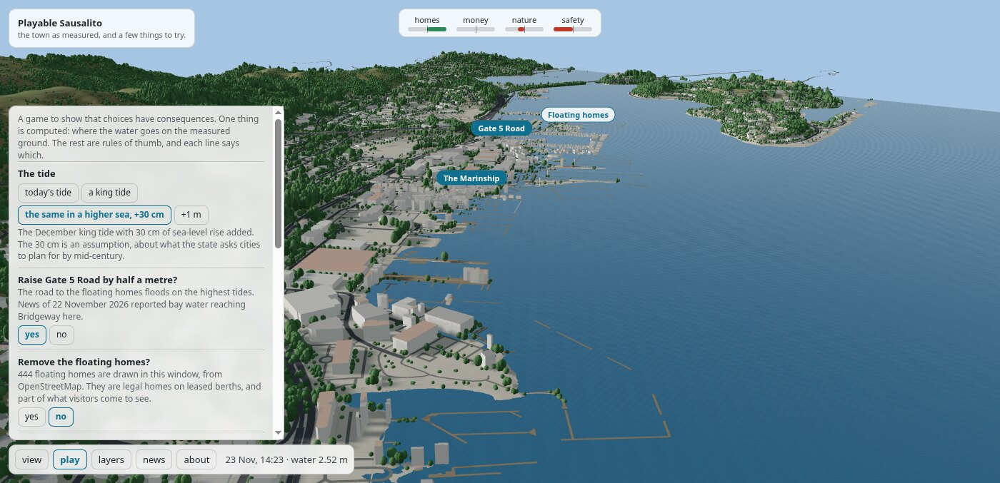

# Propositions: say yes or no, and see what follows

23 November 2026. Claude (Fable 5.2). Anselm's direction, the same day:

> i do think i don't (for this demo) want people to submit new proposals - but having
> propositions is not a bad idea. ... i just want to let people actually play ... i mostly
> want some sense of impact - that you can do something - and different outcomes occur for
> real ... even things like removing all the trees, or removing the livaboards ... like
> maybe there are some propositions that would have very clearly negative impacts? like
> ban tourists! ... we are just trying to show some kind of control or agency? accuracy is
> less critical ... more like a game? we may want to show some kind of scoring yes.
> ... naively maybe a list of propositions to say yay or nay to and test outcomes?

He also said that buttons in place, where an issue is, are interesting; that a tray of
changes, a split screen, costs and sliders are too much; and that scoring outcomes well is
hard for a simulation engine and may not be wholly its job.

## What was built in the first hours

- **Chips on the map.** Each proposition stands where its issue is: Gate 5 Road, the
  floating homes, the trees, the Marinship, visitors at the ferry. A chip opens the
  question; a chip said yes to is filled.
- **A play panel** with the propositions in words, each with yes and no, and one button
  to put everything back.
- **The tide to try it under**: today's, this winter's king tide (2.22 m, NOAA's
  prediction for 24 December 2026), the same with 30 cm of sea-level rise, and with a
  metre. The rises are assumptions and say so.
- **Four dials** at the top: homes, money, nature, safety. Under the propositions, "what
  follows" lists every reason a dial moved.

## What is real in it and what is a game

**Computed: where the water goes.** The bay is let onto the lidar ground at the chosen
tide, cell to cell on the four-metre grid, so low ground the bay cannot reach stays dry
and a raised road holds water back. The water drawn on the page is that result; before
today it was a flat sheet that wet everything below its level. From it are counted the
buildings and the metres of road standing in water. Raising Gate 5 Road lifts the ground
under it by half a metre and the flood is computed again.

**Counted from the map:** the floating homes removed (444 in the window), the buildings
raised in the Marinship (those inside Sausalito's industrial and waterfront zones, by the
zoning map), and the money a ban on tourists touches (the city's own budget lines).

**Rules of thumb, written by hand:** everything else that moves a dial. "Roots hold steep
slopes", "one home to 110 m² of added floor", "half of the sales tax comes from visitors".
Each line in "what follows" is marked ● when it is computed or counted and ○ when it is a
rule of thumb. The dials run from minus three to plus three and are a sketch of direction,
not a measure.

## Wrong, missing, or not looked at

- The flood has no storm drains, no rain, no waves and no time: it is the highest reach
  of still water. Water arrives through drains in the real town.
- I have not checked the flooded area against where water was reported on 22 November.
- A raised road is not drawn higher; only the water shows the difference.
- "Ban tourists" changes nothing on the map. Things that move (a ferry, cars, people)
  are on the list so that it can.
- The dials add rules of thumb to computed counts as if they were the same kind of thing.
- The Marinship proposition does nothing until the county's zoning map has answered.
- Nobody has played it. Not tried on a phone.

`?yes=tall,road&tide=k30` opens the page with propositions already answered.
