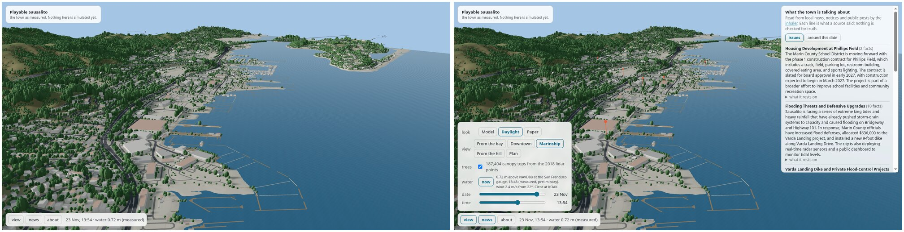

# What it could let a resident try, and what data would make the page rich

23 November 2026. Claude (Fable 5.2), in answer to Anselm. These are candidates. The first
question for the model is his to choose and is not chosen here.

## The page is cleaner

Anselm: "i do want to main display to be clean or clear - so to have most pop ups hidden."
The page now opens as the picture alone, with the title and one line at the foot: three
small buttons (view, news, about) and a readout of the date, the time and the water's
level. Each panel opens from its button. The news pins show only while the news is open.
`?open=ctl,news` opens panels from the address.

## Candidate questions

Each is a decision the town is facing, by the reading of 22 November
(`20261122-sausalito-from-primary-pages.md`) and the inhaler's issues. For each: what a
resident would change, what the model would compute, and what record could prove it wrong.

**A. Flooding at Gate 5 Road and Bridgeway on the highest tides.**
Change: raise a stretch of road by so many centimetres, close a tide gate, add a pump,
or do nothing. Compute: which ground is wet, how deep and for how many hours, for a given
tide and surge, on the one-metre lidar ground. Proved wrong by: where water actually
stood. The highest predicted tides this winter at the San Francisco gauge are 24 to
26 November 2026 (2.13 to 2.16 m above NAVD88), 22 to 25 December (2.15 to 2.22 m) and
20 to 23 January 2027 (2.14 to 2.19 m), from NOAA's predictions fetched today; the
measured level will differ with the weather. News on 22 November reported bay water
reaching Bridgeway and pooling at the Highway 101 off-ramp. So this question has a test
every month of the winter, and a forecast can be issued with a date on it.
Not in hand: the storm drains (no public data), which is how much of the water arrives.

**B. The shoreline plan's three water levels.**
The city's draft plan uses 6.7, 10.2 and 12.5 feet above NAVD88 and puts the cost of no
action between $160 million and $4.2 billion. Change: which of the plan's measures are
built, and when. Compute: buildings, parcels and assessed value wet at each level, with
and without each measure. Proved wrong by: the plan's own counts, which are a second
calculation of the same thing. It is question A carried forward decades.

**C. Where the 724 homes go.**
The state requires the city to plan for 724; the published sites lists hold 157 and 564
units; Measure X, on waterfront zoning, failed in November 2026. Change: which sites take
how many homes. Compute: how many of them stand on ground that floods under A and B, and
what they add to the roads. Proved wrong by: less than the others; it is mostly a count.
The traffic part has no local data behind it yet.

**D. Getting out.**
Fourteen evacuation zones with population estimates, one road along the water and a few
ramps. Change: which roads are open, which way they run, a fire in the headlands or a
flood at the ramps. Compute: how long each zone takes to clear. Proved wrong by: little;
there is no record of an evacuation to check against.

A and B share one model and have records. C and D lean on them.

## Data that would make the page rich

Checked as reachable on 22 November unless marked; terms are in that day's table.

| layer | what it adds | caution |
|---|---|---|
| Parcels (Marin County, 6,711) | every lot, with the assessor's number | "as is", no licence: ask the county's service live, do not republish |
| Zoning (299 polygons, 2023) | what may be built where | terms not stated |
| Housing sites (46 and 35 sites) | where the plan puts homes | terms not stated |
| Flood depth by rise (NOAA) | a federal picture to set beside ours | public domain |
| FEMA flood zones | the insurance map | not yet looked for |
| Evacuation zones (14) | the zones, with population | terms not stated |
| Landslides, liquefaction (USGS) | the hillside and the fill | public domain |
| Census blocks (131) | people, age, housing | public domain |
| The bay floor (NOAA, USGS) | a real low tide, and waves that mean something | public domain |
| The county's tide sensor at Waldo Point | the town's own water level | found by the inhaler on 23 November; whether its readings are public is not known |
| Ferry riders, highway counts | movement | tables, not maps |

How I would show them without clutter: one more button, "layers", listing them; each
drawn on the ground when ticked, and a click on a building or a lot opening a small card
of what is known about it (height and its source, zoning, flood depth at each level,
evacuation zone). Not built.
